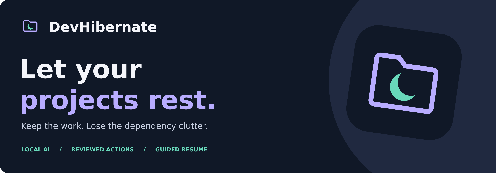

<p align="center">
  
</p>

<h1 align="center">DevHibernate</h1>

<p align="center">
  <strong>Keep the project. Release the resources. Return when ready.</strong><br>
  A local, AI-assisted tool that reclaims dependency storage from shelved dev projects —
  without touching your source, config, or local data.
</p>

<p align="center">
  
  
  
  
  
  
  
  
  
</p>

---

## Why

Every shelved side project keeps its entire `node_modules` on disk indefinitely. DevHibernate puts a project to **sleep** — it removes the recreatable dependency artifacts you can reinstall later, while preserving everything you can't: your source, your Git history, your lockfiles, and your `.env`.

Hibernation is **not** deletion. It is "release the recoverable, keep the irreplaceable."

---

## How It Works

DevHibernate runs on a single, auditable chain:

```
Root → Project → Scan → Candidate → Plan → Operation → Resume Record
```

A metadata-only scan finds projects, a local model proposes a hibernation plan from a restricted inventory (never your file contents), deterministic policy validates it, and only a reviewed, approved plan can reach the executor.

---

## The Data Model

Each step in the chain is a table. Every field below exists in the schema (`apps/server/src/db.ts`).

### `roots`
A folder you registered on your machine (e.g. `~/dev`). One root can contain many projects.
| Field | Meaning |
|---|---|
| `canonical_path` | Absolute, normalized path of the registered folder |
| `enabled` | Whether this root is active for scanning |

### `projects`
A standalone project discovered inside a root, detected by markers like `package.json`.
| Field | Meaning |
|---|---|
| `relative_location` | Path of the project relative to its root (`.` = the root itself) |
| `ecosystem` | Detected ecosystem (e.g. `node`) |
| `status` | Lifecycle: `discovered → shelved → hibernated → resume_pending → active` |
| `pinned` | Protected — never touched |
| `user_shelved` | Marked by the user as ready to hibernate |

### `scans`
A single discovery pass over a root. Reads filenames and metadata only — never file contents.
| Field | Meaning |
|---|---|
| `limits` | Bounds applied (depth, time budget) |
| `completeness` | `complete` or `partial` |
| `errors` | Any errors captured during the pass |

### `candidates`
A directory that could be removed. In Phase 1 the only candidate kind is `node_modules`.
| Field | Meaning |
|---|---|
| `kind` | Candidate type (e.g. `node_modules`) |
| `relative_target` | Path of the removable directory within the project |
| `logical_bytes` | Estimated size (not exact freed disk space) |
| `entry_count` | Number of entries measured |
| `fingerprint` | Metadata hash for detecting change before removal |
| `policy_version` | Which ruleset was applied |
| `blockers` | Reasons it can't be removed (e.g. a `.env` inside it) |

### `plans`
An AI-assisted hibernation assessment for a project. **Plans expire after 5 minutes.**
| Field | Meaning |
|---|---|
| `candidate_ids` | Candidates selected for removal |
| `model_result` | The model's validated recommendation + restart checklist |
| `expires_at` | When the plan goes stale |
| `status` | `generating → reviewable → …` |

### `operations`
An actual deletion execution — the highest-risk module. It never accepts a path from the browser.
| Field | Meaning |
|---|---|
| `selected_ids` | Candidates actually removed |
| `idempotency_key` | Prevents a double-submit from running twice |
| `per_target_results` | Per-candidate outcome (success / partial / failed) |
| `failure_reason` | Why the operation failed, if it did |

### `resume_records`
Instructions for getting the project running again.
| Field | Meaning |
|---|---|
| `detected_markers` | Markers found (`package.json`, lockfiles, …) |
| `suggested_steps` | Suggested reinstall commands (e.g. `npm ci`) |
| `removed_artifacts` | What was removed |
| `verification_status` | Whether the user confirmed it runs again |

---

## Privacy Contract

- The scanner **never reads project file contents** — filenames and sizes only.
- The local model receives a **restricted inventory** — never `.env`, source, credentials, or absolute paths.
- Secrets are never opened, sent to a model, placed in telemetry, or logged.
- Deletion is permanent; reinstall is a guide, **not** an undo guarantee.

---

## Quick Start

**Prerequisites:** Node **24 LTS** (the native `better-sqlite3` build targets it), and [Ollama](https://ollama.com/) with `gemma3:1b` for the assessment step.

```bash
# use Node 24 (via nvm, fnm, or your manager of choice)
nvm use 24

# configure environment
cp .env.example .env

# install and run (UI + API)
npm install
npm run dev
```

Open **http://localhost:5173** — the API runs on **http://127.0.0.1:4317**, and API docs are at **/docs**.

---

## Scripts

| Command | Purpose |
|---|---|
| `npm run dev` | Start UI + server in development |
| `npm run build` | Build UI and server for production |
| `npm run start` | Run the built app on loopback |
| `npm run lint` | Lint all code |
| `npm run typecheck` | TypeScript checks |
| `npm run test` | Unit + integration tests |
| `npm run test:e2e` | Playwright end-to-end tests |

---

## Architecture

| Layer | Stack |
|---|---|
| **UI** | React + TypeScript + Vite |
| **API** | Express + TypeScript on Node 24 LTS (loopback only, per-run token, Origin checks) |
| **State** | SQLite via better-sqlite3 |
| **Validation** | Zod |
| **AI** | Ollama (`gemma3:1b`), local only — no cloud fallback |

---

## Project Status

Phase 1 (macOS, standalone npm projects) is in active development: register → scan → inventory → local assessment → reviewed removal → guided resume. The executor stays behind review and its release gate; apply is not enabled until its tests pass. See `ROADMAP.md` for phases and gates.

---

## License

2026 — All rights reserved · [wamzii.com](https://wamzii.com)
